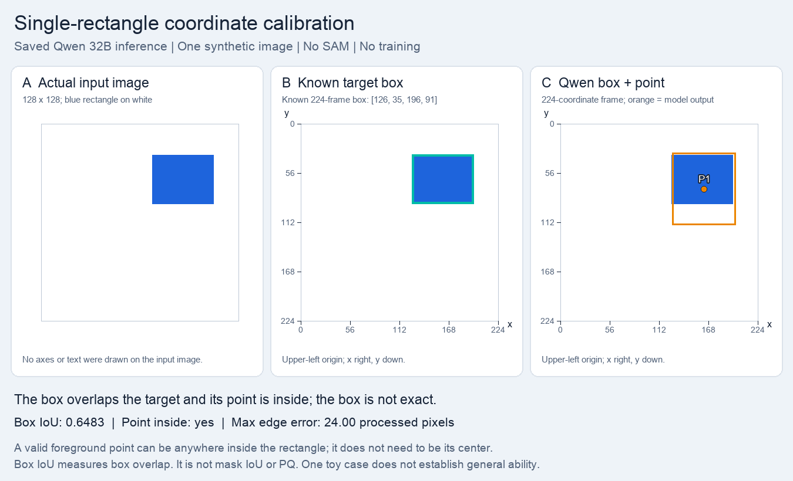

# One-rectangle coordinate calibration

The model localized a simple synthetic rectangle approximately, but its bottom box edge extended 24 processed pixels beyond the target. This establishes partial success on one obvious target, not reliable nucleus localization.

| Measure | Saved result |
|---|---|
| Native / processed frame | 128×128 / 224×224 |
| Expected box | [126,35,196,91] |
| Generated box / point | [127,33,199,115] / [163,74] |
| Box IoU | 0.6483 |
| Point inside rectangle | Yes |
| Signed edge errors | [1,-2,3,24] |
| Format / emitted / accepted | Valid / 1 / 1 |

Box IoU compares rectangles, not segmentation masks or PQ. The point only needs to be inside the target, not at its center. The blue rectangle is exactly RGB [30,100,220] on a white background; the target spans x=[72,112), y=[20,52) in native coordinates. No labels or coordinate axes appear in the model input.

## Controls and interpretation

Frozen Qwen2.5-VL-32B-Instruct, revision `7cfb30d71a1f4f49a57592323337a4a4727301da`; no LoRA, SAM calls, or parameter updates. One greedy completion per task, seed 42, at most 512 new tokens. Exact prompts, unmodified raw answers, input hashes, and calculated values are in [summary.json](summary.json). These are selected engineering examples, not dataset accuracy or a comparison with Iris's baseline.

## Source and preserved evidence

The pathology examples use selected crops from the canonical [MoNuSeg training sources](https://monuseg.grand-challenge.org/Data/); source membership is recorded in the [official-30 protocol](../../protocols/README.md). Ground truth is used for selection and checking, not supplied as a model answer. The synthetic rectangle has no patient data. These summaries do not alter the original result, parser, completion, or metrics. Large tensors, checkpoints, and raw dataset archives remain outside this report.

Local evidence: `runs/coordinate_calibration_32b_20261015/`. Source result SHA-256: `701c13ca077e013289470c678882f38b8b64e1d939949651692cec0569d14286`.
