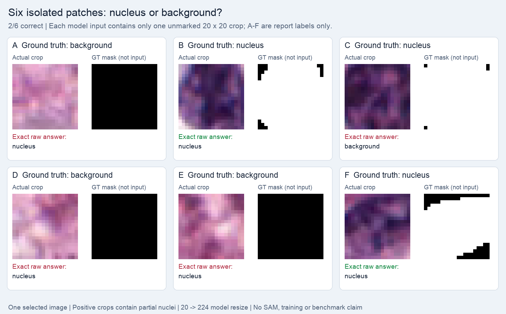

# Six unmarked patches: binary classification

The six fixed candidate squares were cropped from the **unmarked** original image and shown separately. Each fresh-context input contains one native 20×20 crop; the model receives no letter ID, coordinate, GT mask, or earlier answer.

| Report ID only | GT center label | Exact raw answer | Correct |
|---|---|---|---|
| A | background | nucleus | No |
| B | nucleus | nucleus | Yes |
| C | nucleus | background | No |
| D | background | nucleus | No |
| E | background | nucleus | No |
| F | nucleus | nucleus | Yes |

**2/6 correct; all six formats valid.** TP=2, TN=0, FP=3, FN=1. Invalid-output count is zero; this result reflects classification errors under this prompt. A, D, E contain no annotated foreground; B, C, F contain 94.75%, 99%, and 83% foreground respectively.

Positive crops contain partial nuclei. The unchanged processor enlarges native 20×20 inputs to 224×224; no manual resize is applied. Cropping removes context and increases effective object magnification relative to the earlier full image. This cannot isolate the earlier failure's cause or establish dataset accuracy, nucleus-detection recall, or mask PQ.

## Controls and interpretation

Frozen Qwen2.5-VL-32B-Instruct, revision `7cfb30d71a1f4f49a57592323337a4a4727301da`; no LoRA, SAM calls, or parameter updates. One greedy completion per task, seed 42, at most 512 new tokens. Exact prompts, unmodified raw answers, input hashes, and calculated values are in [summary.json](summary.json). These are selected engineering examples, not dataset accuracy or a comparison with Iris's baseline.

## Source and preserved evidence

The pathology examples use selected crops from the canonical [MoNuSeg training sources](https://monuseg.grand-challenge.org/Data/); source membership is recorded in the [official-30 protocol](../../protocols/README.md). Ground truth is used for selection and checking, not supplied as a model answer. The synthetic rectangle has no patient data. These summaries do not alter the original result, parser, completion, or metrics. Large tensors, checkpoints, and raw dataset archives remain outside this report.

Local evidence: `runs/isolated_crop_probe_32b_20261015/`. Source result SHA-256: `4b1ba4f02ba4067f1fa33e69d1eb1188c7a05c7313ab6094d55fda068ec28e1b`.
