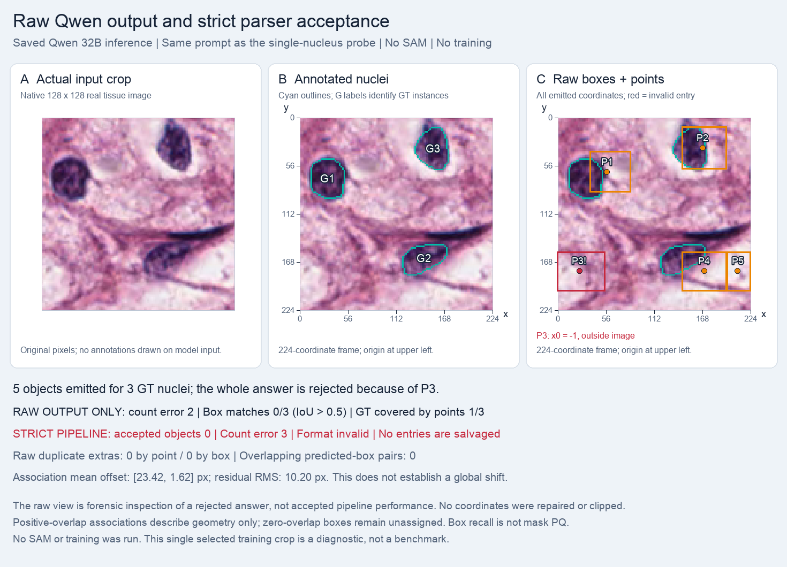

# Three nuclei: five objects emitted, zero accepted

**Qwen emitted five box-and-point entries.** P3 has x0=-1, so the unchanged strict parser rejected the whole answer and accepted zero objects. Zero accepted does not mean zero emitted. No clipping, repair, selective salvage, or retry was applied.

| Measure | Unchanged strict pipeline | Raw-output inspection only |
|---|---:|---:|
| Annotated nuclei | 3 | 3 |
| Object count | 0 accepted | 5 emitted |
| Absolute count error | 3 | 2 |
| One-to-one box matches, IoU > 0.5 | 0/3 | 0/3 |
| Points inside distinct nuclei | 0 | 1/3 |

Raw best box IoUs are P1→G1: 0.1716, P2→G3: 0.4532, P4→G2: 0.2145; P3 and P5 have zero overlap and remain unassigned. Only P2's point lies on annotated foreground. No point duplicates or same-GT box duplicates above IoU 0.5 were found; zero duplicates does not imply accurate detection.

All three positive-overlap associations have rightward box-center errors, but their vertical errors differ. This does not establish a single global shift or justify moving predictions to improve the score. The raw inspection retains the full area of out-of-bounds boxes. Box recall is not mask PQ.

The image changed from the single-nucleus probe, while the initial prompt, checkpoint, coordinate frame, and decoding settings stayed identical. Selection used GT to obtain three complete nuclei, so this is a deliberate diagnostic rather than a representative test sample.

## Controls and interpretation

Frozen Qwen2.5-VL-32B-Instruct, revision `7cfb30d71a1f4f49a57592323337a4a4727301da`; no LoRA, SAM calls, or parameter updates. One greedy completion per task, seed 42, at most 512 new tokens. Exact prompts, unmodified raw answers, input hashes, and calculated values are in [summary.json](summary.json). These are selected engineering examples, not dataset accuracy or a comparison with Iris's baseline.

## Source and preserved evidence

The pathology examples use selected crops from the canonical [MoNuSeg training sources](https://monuseg.grand-challenge.org/Data/); source membership is recorded in the [official-30 protocol](../../protocols/README.md). Ground truth is used for selection and checking, not supplied as a model answer. The synthetic rectangle has no patient data. These summaries do not alter the original result, parser, completion, or metrics. Large tensors, checkpoints, and raw dataset archives remain outside this report.

Local evidence: `runs/multi_nucleus_probe_32b_20261015/`. Source result SHA-256: `11a9c43df8163aa3048c46b0fd3467ff57f615bd4eff3821bf4c3fac9d1dc10a`.
