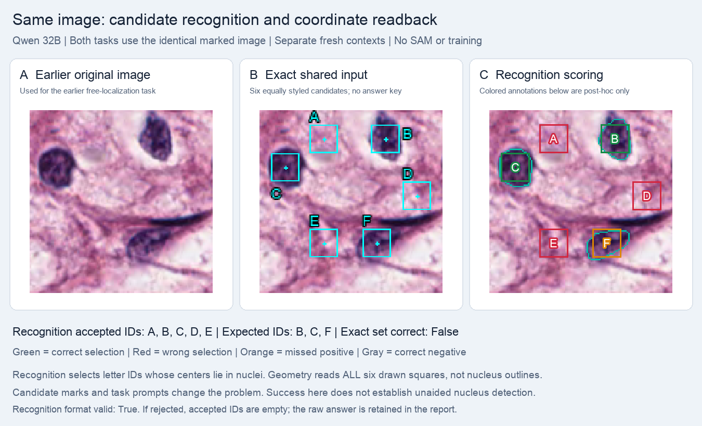
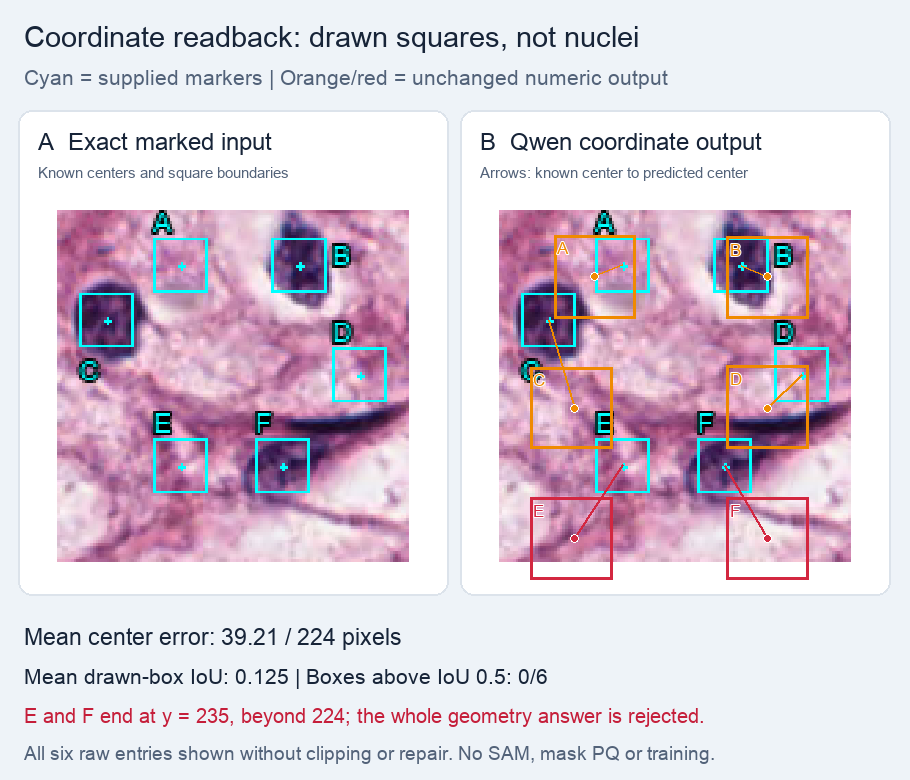

# Candidate recognition versus coordinate readback

Two fresh-context tasks receive the **same marked image tensor**, with six equally styled squares A–F. Recognition selects IDs whose centers lie in nuclei; geometry reads every artificial square's box and center without classifying tissue. Neither task fully succeeds.

| Task | Saved result |
|---|---|
| Recognition expected / selected IDs | B,C,F / A,B,C,D,E |
| Candidate classification accuracy | 2/6 |
| Positive-candidate recall / selection precision | 2/3 / 2/5 |
| Recognition format | Valid |
| Geometry emitted / strictly accepted | 6 / 0 |
| Mean raw square-box IoU | 0.1251 |
| Mean raw center error | 39.21 processed pixels |

E and F have y1=235 beyond the 224-pixel frame, rejecting the entire geometry answer. Continuous geometry errors retain all unmodified raw entries; they are not accepted predictions. None meets the predeclared combined tolerance of box IoU >0.5 and center error ≤7 processed pixels. This is an engineering check, not a medical performance threshold.

Candidate assistance changes the input and task relative to free localization. Recognition also requires matching letters to regions; artificial-square readback is not nucleus-boundary generation. The outcome does not establish that the model recognized nuclei correctly and only wrote wrong coordinates, or that it has no recognition ability. GT labels, positive counts, and true coordinates were not supplied to the model.

## Controls and interpretation

Frozen Qwen2.5-VL-32B-Instruct, revision `7cfb30d71a1f4f49a57592323337a4a4727301da`; no LoRA, SAM calls, or parameter updates. One greedy completion per task, seed 42, at most 512 new tokens. Exact prompts, unmodified raw answers, input hashes, and calculated values are in [summary.json](summary.json). These are selected engineering examples, not dataset accuracy or a comparison with Iris's baseline.

## Source and preserved evidence

The pathology examples use selected crops from the canonical [MoNuSeg training sources](https://monuseg.grand-challenge.org/Data/); source membership is recorded in the [official-30 protocol](../../protocols/README.md). Ground truth is used for selection and checking, not supplied as a model answer. The synthetic rectangle has no patient data. These summaries do not alter the original result, parser, completion, or metrics. Large tensors, checkpoints, and raw dataset archives remain outside this report.

Local evidence: `runs/recognition_coordinate_probe_32b_20261015/`. Source result SHA-256: `f1cfd85f3aacd06b4110a57e42c821bd9991b9e9e79fadd6998ae3eb25632c6e`.
