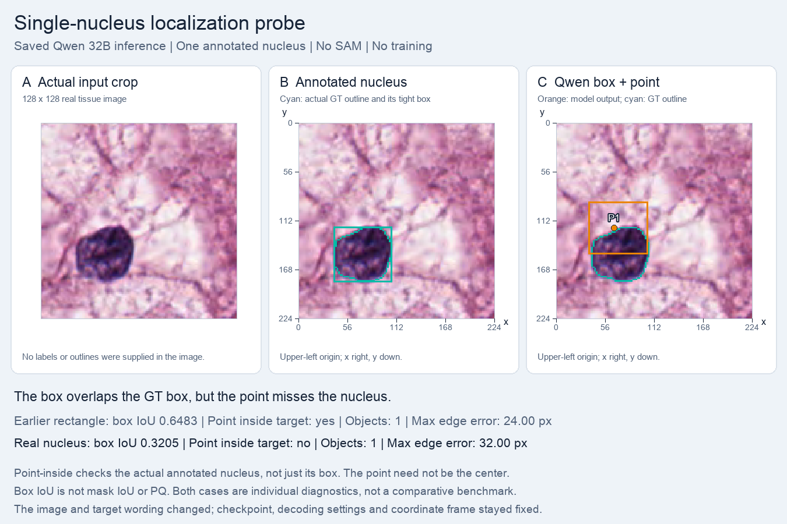

# One real nucleus: localization remains inaccurate

On one selected real nucleus, the model produced a valid box and point, but the box was vertically displaced. The point lies within the GT bounding box while missing the actual annotated foreground.

| Measure | Saved result |
|---|---|
| Expected box (224 frame) | [40.25,119,106.75,182] |
| Generated box / point | [37,90,105,150] / [66,120] |
| Box IoU | 0.3205 |
| Point inside GT box / actual nucleus | Yes / No |
| Format / emitted / accepted | Valid / 1 / 1 |

The native 128×128 crop contains one complete annotated nucleus away from its edges. It was selected using GT from an official-30 training source. Compared with the earlier rectangle, the image and target wording changed while the checkpoint, decoding settings, and coordinate convention stayed fixed. Two different examples cannot estimate generalization or identify a unique failure cause. No mask or PQ is produced here.

## Controls and interpretation

Frozen Qwen2.5-VL-32B-Instruct, revision `7cfb30d71a1f4f49a57592323337a4a4727301da`; no LoRA, SAM calls, or parameter updates. One greedy completion per task, seed 42, at most 512 new tokens. Exact prompts, unmodified raw answers, input hashes, and calculated values are in [summary.json](summary.json). These are selected engineering examples, not dataset accuracy or a comparison with Iris's baseline.

## Source and preserved evidence

The pathology examples use selected crops from the canonical [MoNuSeg training sources](https://monuseg.grand-challenge.org/Data/); source membership is recorded in the [official-30 protocol](../../protocols/README.md). Ground truth is used for selection and checking, not supplied as a model answer. The synthetic rectangle has no patient data. These summaries do not alter the original result, parser, completion, or metrics. Large tensors, checkpoints, and raw dataset archives remain outside this report.

Local evidence: `runs/single_nucleus_probe_32b_20261015/`. Source result SHA-256: `de56617686c6e51a408980abb3e6f80eecab95fadfd2629b7b46db044a659579`.
