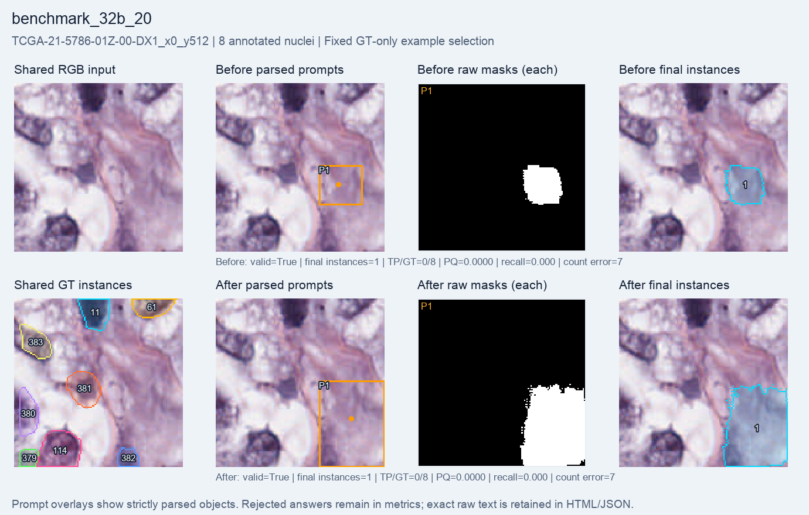

# 32B: 20-step H200 timing check

A fresh Qwen2.5-VL-32B LoRA run completed **20 optimizer steps**, all with **nonzero gradients**. The final adapter hash differs from its initial hash. SAM2.1 tiny and the Qwen vision encoder stayed frozen. This checks execution and speed; it is separate from the longer experiments.

**One additional nucleus matched: 0 → 1 out of 51.** Two of eight responses remained invalid in each phase. This small selected subset does not establish a robust improvement or an advantage from model size.

| Metric | Before | After |
| --- | ---: | ---: |
| Macro PQ | 0.000000 | 0.012597 |
| Macro recall | 0.000000 | 0.031250 |
| Micro recall | 0.000000 | 0.019608 |
| Matched / annotated nuclei | 0 / 51 | 1 / 51 |
| Final instances | 17 | 14 |
| Count MAE | 5.750 | 5.625 |
| Same-GT duplicate extras | 0 | 0 |
| Raw-mask overlap pairs | 0 | 0 |
| Valid answers | 6 / 8 | 6 / 8 |
| Mean foreground IoU | 0.044950 | 0.048071 |

Macro metrics average crops equally; micro recall pools matched and annotated nuclei. Count MAE uses final instances. Duplicate extras count raw SAM masks matching the same GT at IoU > 0.5; raw-mask overlap pairs are a separate proxy. Both zero values describe these definitions, not a guarantee of perfect separation.

Invalid responses are not silently discarded. Each contains a box outside the allowed image bounds, so the strict parser rejects its whole answer and the final mask is empty. These crops remain in the metric denominators. The exact emitted text remains in the completion records; zero accepted instances does not mean the model emitted no objects.

| Setting or resource | Value |
| --- | --- |
| Training pool | 256 selected crops, 19 patients |
| Evaluation | Fixed benchmark8 subset of validation64; 8 crops, 4 patients, 51 annotated nuclei |
| Policy | Fresh Qwen2.5-VL-32B-Instruct; language LoRA rank 8 |
| Optimizer configuration | Learning rate 1e-5; seed 42; group size 2; beta 0.04 |
| Reward | Format validity + binary foreground IoU against full masks |
| Segmenter | Frozen SAM2.1 tiny |
| Training time | 152.655 seconds |
| Total runner time | 270.718 seconds |
| Training-step peak allocated memory | 63.672 GiB |
| Training-step peak reserved memory | 64.750 GiB |

The training pool contains 256 crops; a 20-step run does not mean it saw all of them. Evaluation uses greedy generation before and after training. Train and validation patients are disjoint. All crops come from the official-30 MoNuSeg training cohort; native 128 × 128 crops with 1–8 annotated nuclei were selected, and partial edge nuclei were retained.

## Fixed example

The multiple-nucleus example is the lexicographically first eligible ID, chosen using GT count without examining predictions. It is the same example used for the 7B timing check. The benchmark8 subset contains **no single-nucleus crop**; no prediction from an unevaluated crop is substituted.

The figure shows the same RGB input and GT, then parsed boxes/points, every raw SAM mask, and final instances before and after. Saved GT instance IDs are labels, not nucleus counts. This fixed example has zero matches in both phases; it was not selected to display the one improvement elsewhere.

## Evidence and limits

Every saved final map and raw-mask file was present (8 before and 8 after). The report independently reparsed the answers and recomputed final-mask scores and duplicate diagnostics; source hashes and stored values matched. Exact completion records are retained byte-for-byte. No model was run to render the report.

This selected eight-crop validation subset measures timing and early behavior. It is not an untouched test set or a representative benchmark. Twenty steps cannot establish the effect of longer training. Do not pool these results with validation64. This is a full-mask engineering pilot, with no weak-label, SOTA or clinical claim.

[Visual report](index.html) · [Settings, exact metrics and provenance](summary.json) · [All before answers](before_records.jsonl) · [All after answers](after_records.jsonl).
