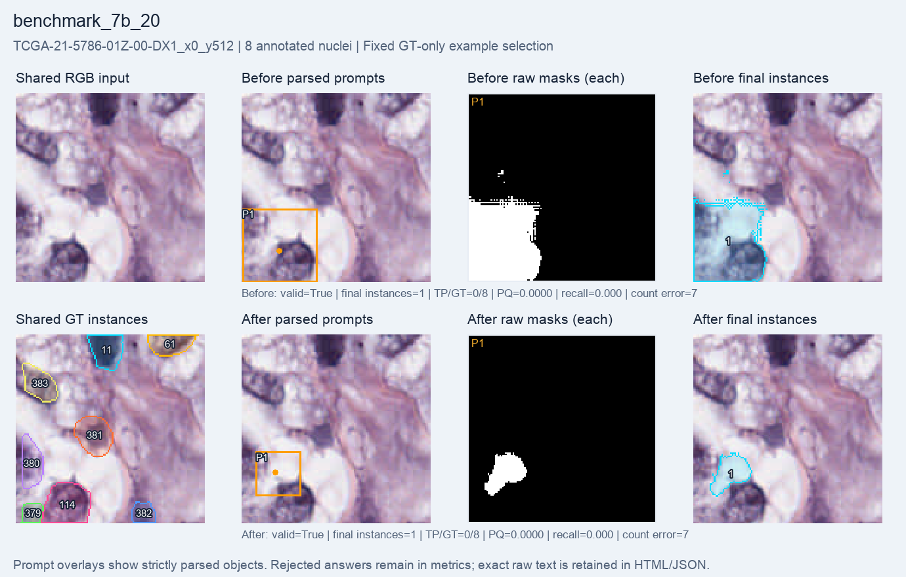

# 7B: 20-step H200 timing check

A fresh Qwen2.5-VL-7B LoRA run completed **20 optimizer steps**, including **19 steps with nonzero gradients and changed adapter parameters**. SAM2.1 tiny and the Qwen vision encoder stayed frozen. This checks execution and speed; it is separate from the longer experiments.

**Matching did not improve.** The model produced more final instances, but matched only one annotated nucleus both before and after. Lower count error alone is not evidence of better detection.

| Metric | Before | After |
| --- | ---: | ---: |
| Macro PQ | 0.015843 | 0.010976 |
| Macro recall | 0.017857 | 0.015625 |
| Micro recall | 0.019608 | 0.019608 |
| Matched / annotated nuclei | 1 / 51 | 1 / 51 |
| Final instances | 8 | 15 |
| Count MAE | 5.375 | 4.500 |
| Same-GT duplicate extras | 0 | 0 |
| Raw-mask overlap pairs | 0 | 0 |
| Valid answers | 8 / 8 | 8 / 8 |
| Mean foreground IoU | 0.047609 | 0.017027 |

Macro metrics average crops equally; micro recall pools matched and annotated nuclei. Count MAE uses final instances. Duplicate extras count raw SAM masks matching the same GT at IoU > 0.5; raw-mask overlap pairs are a separate proxy. Both zero values describe these definitions, not a guarantee of perfect separation.

| Setting or resource | Value |
| --- | --- |
| Training pool | 256 selected crops, 19 patients |
| Evaluation | Fixed benchmark8 subset of validation64; 8 crops, 4 patients, 51 annotated nuclei |
| Policy | Fresh Qwen2.5-VL-7B-Instruct; language LoRA rank 8 |
| Optimizer configuration | Learning rate 1e-5; seed 42; group size 2; beta 0.04 |
| Reward | Format validity + binary foreground IoU against full masks |
| Segmenter | Frozen SAM2.1 tiny |
| Training time | 51.260 seconds |
| Total runner time | 94.214 seconds |
| Training-step peak allocated memory | 16.436 GiB |
| Training-step peak reserved memory | 17.064 GiB |

The training pool contains 256 crops; a 20-step run does not mean it saw all of them. Evaluation uses greedy generation before and after training. Train and validation patients are disjoint. All crops come from the official-30 MoNuSeg training cohort; native 128 × 128 crops with 1–8 annotated nuclei were selected, and partial edge nuclei were retained.

## Fixed example

The multiple-nucleus example is the lexicographically first eligible ID, chosen using GT count without examining predictions. The benchmark8 subset contains **no single-nucleus crop**; no prediction from an unevaluated crop is substituted.

The figure shows the same RGB input and GT, then parsed boxes/points, every raw SAM mask, and final instances before and after. Saved GT instance IDs are labels, not nucleus counts. The full validation cohort is used separately by the longer runs.

## Evidence and limits

Every saved final map and raw-mask file was present (8 before and 8 after). The report independently reparsed the answers and recomputed final-mask scores and duplicate diagnostics; source hashes and stored values matched. Exact completion records are retained byte-for-byte. No model was run to render the report.

This selected eight-crop validation subset measures timing and early behavior. It is not an untouched test set or a representative benchmark. Twenty steps cannot establish the effect of longer training. Do not pool these results with validation64. This is a full-mask engineering pilot, with no weak-label, SOTA or clinical claim.

[Visual report](index.html) · [Settings, exact metrics and provenance](summary.json) · [All before answers](before_records.jsonl) · [All after answers](after_records.jsonl).
