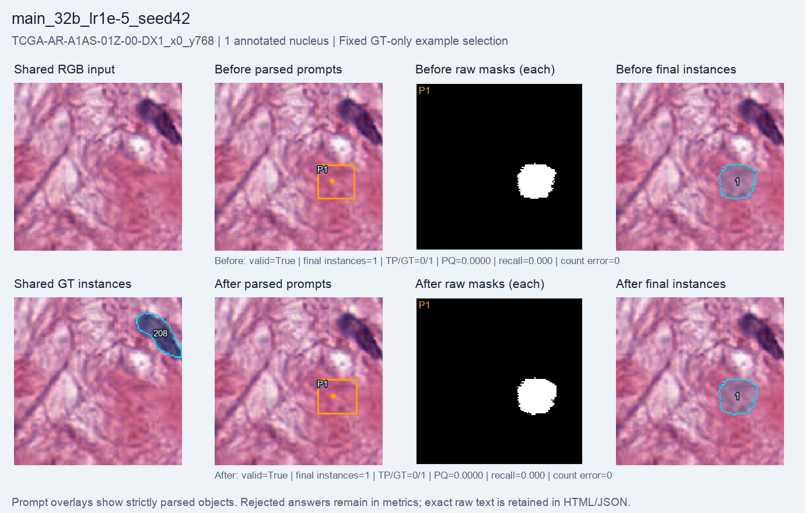
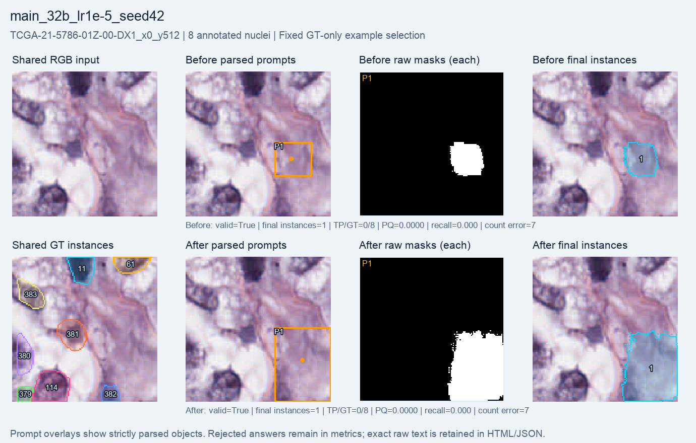

# 32B, learning rate 1e-5: 400-step GRPO run

A fresh Qwen2.5-VL-32B language-LoRA run completed **400 optimizer steps**, all with **nonzero gradients**. The final adapter hash changed; SAM2.1 tiny and the Qwen vision encoder stayed frozen. Evaluation uses the same **64 validation crops, four patients and 384 crop-level GT occurrences (340 unique source nuclei)** before training and after the final step.

**Macro PQ rose from 0.01414 to 0.01687; matched GT occurrences rose from 7 to 10.** Count MAE and coordinate-contract validity worsened slightly, while foreground IoU decreased. Most nuclei remain unmatched. This 400-step run cannot isolate a model-size effect against 1,000-step 7B runs.

| Metric | Before | After 400 steps |
| --- | ---: | ---: |
| Macro PQ | 0.014142 | 0.016870 |
| Macro recall | 0.016183 | 0.023344 |
| Micro recall | 0.018229 | 0.026042 |
| Matched / GT occurrences | 7 / 384 | 10 / 384 |
| Final instances | 119 | 121 |
| Count MAE | 4.515625 | 4.640625 |
| Same-GT duplicate extras | 0 | 0 |
| Raw-mask overlap pairs | 3 | 0 |
| Valid answers | 47 / 64 | 46 / 64 |
| Mean foreground IoU | 0.053238 | 0.048517 |
| Mean total reward | 0.787613 | 0.767267 |

Macro metrics average crops equally; micro recall pools matched and annotated instances within each crop. Count MAE uses final instances. Duplicate extras count raw SAM masks matching the same GT at IoU > 0.5; raw-mask overlap pairs are a separate proxy. Zero values under these definitions do not establish successful instance detection.

**Coordinate errors caused whole-response rejection.** All 17 rejected before answers and all 18 rejected after answers contain out-of-bounds boxes in the declared 224 × 224 prompt frame. Their JSON decodes; the coordinate contract fails. The parser rejects the entire response, and its empty final mask remains in every metric denominator. Exact raw text is retained; zero accepted instances does not mean no objects were emitted. No coordinates were clipped or repaired.

The saved `adapter_changed_steps=400` counts comparisons against initial weights; it does not verify changes relative to every preceding step. Final adapter-hash change and 400 nonzero-gradient steps are separately recorded.

| Setting or resource | Value |
| --- | --- |
| Training pool | 256 selected crops, 19 patients |
| Evaluation | Full validation64: 64 crops, four patients, 384 GT occurrences from 340 unique source nuclei |
| Policy | Fresh Qwen2.5-VL-32B-Instruct; language LoRA rank 8 |
| Optimizer configuration | Learning rate 1e-5; seed 42; group size 2; beta 0.04 |
| Reward | Format validity + binary foreground IoU against full masks |
| Segmenter | Frozen SAM2.1 tiny |
| Completed / requested optimizer steps | 400 / 400 |
| Checkpoint evaluated here | Final step 400; not the best intermediate checkpoint |
| Periodic evaluations | Three; every 100 steps before the final evaluation |
| Training-loop elapsed, including periodic evaluation/checkpoints | 4,221.196 seconds (70.353 minutes) |
| Before / after evaluation | 327.456 / 344.237 seconds |
| Total runner time | 4,936.168 seconds (82.269 minutes) |
| Training-step peak allocated memory | 63.958 GiB |
| Training-step peak reserved memory | 66.453 GiB |

Total time also includes loading and final evaluation/saving. Evaluation uses greedy generation. Train and validation patients are disjoint. The official-30 MoNuSeg training cohort supplies native 128 × 128 crops selected to contain 1–8 annotated nuclei; partial edge nuclei are retained.

## Fixed single-nucleus example

`TCGA-AR-A1AS-01Z-00-DX1_x0_y768` is the only validation64 crop with one annotated nucleus. The predictions remain in the wrong location, with zero matches before and after. Count error is zero in both phases despite this localization failure.

## Fixed multiple-nucleus example

`TCGA-21-5786-01Z-00-DX1_x0_y512` is the first eligible multi-nucleus ID lexicographically, with eight annotated nuclei. Both phases produce one final instance and match none of the eight nuclei. Count error remains seven.

Both examples were fixed by GT count and ID order before examining predictions and are identical across main64 reports. Panels show shared RGB/GT, parsed boxes/points, every raw mask and final instances. Saved GT IDs are object labels, not counts; edge fragments are retained.

## Unequal-budget context

| Final metric | 7B, LR 1e-5, seed 42 | 32B, LR 1e-5, seed 42 |
| --- | ---: | ---: |
| Completed steps | 1,000 | 400 |
| Macro PQ | 0.026685 | 0.016870 |
| Matched / GT occurrences | 10 / 384 | 10 / 384 |
| Count MAE | 4.937500 | 4.640625 |
| Valid answers | 61 / 64 | 46 / 64 |

Both evaluations use the same full64 cohort and frozen segmenter. The policy checkpoint and optimization budget differ: 400 steps for 32B versus 1,000 for 7B. This descriptive comparison cannot attribute a difference solely to model size. Exact reference metrics and the source-result hash are in `summary.json`.

## Evidence and limits

The denominator **384** counts GT instances within crops. These correspond to **340 unique source nuclei** because some nuclei straddle neighboring crop boundaries. Such fragments remain within the same patient and split; they do not introduce train/validation leakage. Existing recall remains TP / 384, not TP / 340. Sixty-one of 64 validation crops contain truncated or source-clipped nuclei.

All **64 before and 64 after final maps and raw-mask files** were present and verified. Source hashes, cohort IDs/order, strict parsing, coordinate conversion, final-mask metrics, duplicate diagnostics and freeze/update proofs matched the saved evidence. All 128 raw completion records are copied byte-for-byte. Every rejected response was independently decoded and checked for box-bound violations. No model was run to render this report.

The selected validation cohort is reused for monitoring and setting selection, not an untouched final test. Four patients, one seed and unequal optimization budgets limit comparisons. Only 10 of 384 crop-level GT occurrences match and 18 of 64 final responses are rejected. Do not pool these scores with benchmark8. This is a full-mask engineering pilot, with no weak-label, SOTA or clinical claim.

[Visual report](index.html) · [Exact metrics, settings and provenance](summary.json) · [All before answers](before_records.jsonl) · [All after answers](after_records.jsonl).
