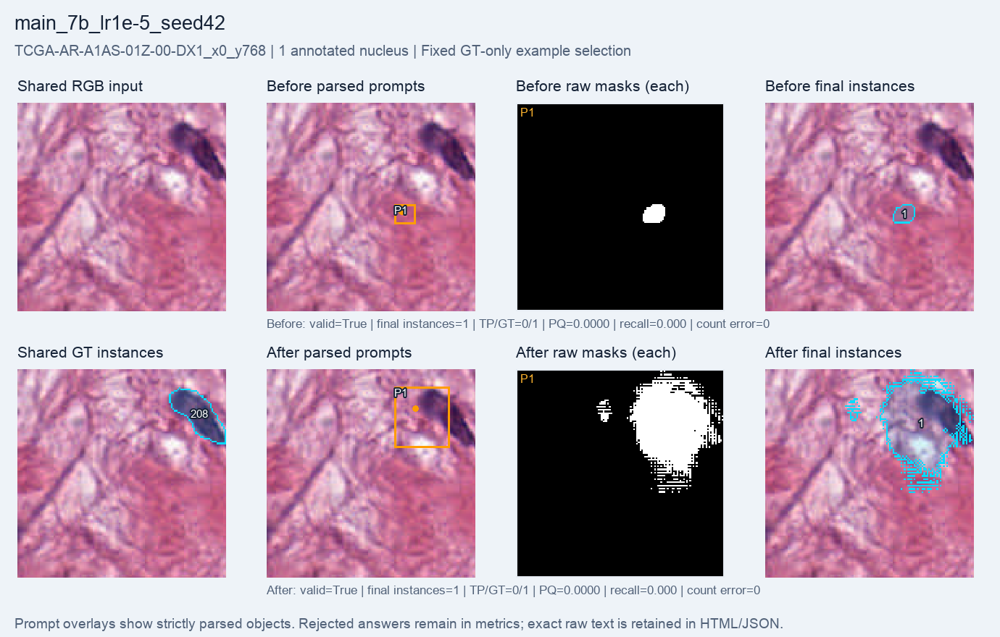
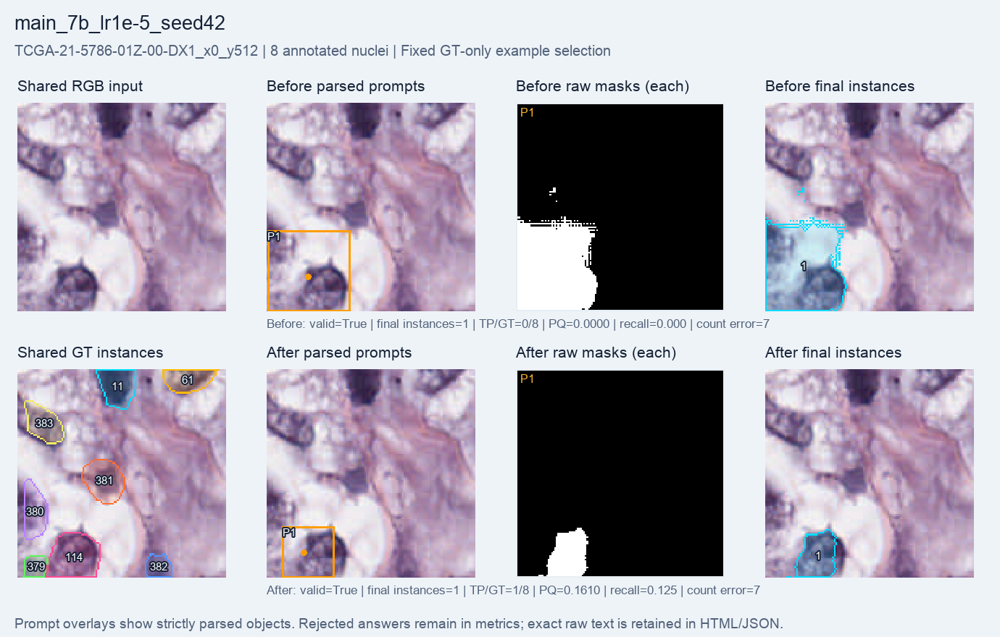

# 7B, learning rate 1e-5: 1,000-step GRPO run

A fresh Qwen2.5-VL-7B language-LoRA run completed **1,000 optimizer steps**, with **999 nonzero-gradient steps**. The final LoRA adapter hash differs from its initial hash. SAM2.1 tiny and the Qwen vision encoder stayed frozen. Evaluation uses the same **64 validation crops, four patients and 384 GT occurrences** before training and after the final step.

**Macro PQ rose from 0.02265 to 0.02668; total matched nuclei rose from 9 to 10.** Count MAE and format validity worsened slightly. Most nuclei are still missed. This one-seed result does not establish a robust improvement or a preferred learning rate.

| Metric | Before | After 1,000 steps |
| --- | ---: | ---: |
| Macro PQ | 0.022655 | 0.026685 |
| Macro recall | 0.021540 | 0.025316 |
| Micro recall | 0.023438 | 0.026042 |
| Matched / GT occurrences | 9 / 384 | 10 / 384 |
| Final instances | 73 | 68 |
| Count MAE | 4.921875 | 4.937500 |
| Same-GT duplicate extras | 0 | 1 |
| Raw-mask overlap pairs | 15 | 8 |
| Valid answers | 62 / 64 | 61 / 64 |
| Mean foreground IoU | 0.064296 | 0.114109 |
| Mean total reward | 1.033046 | 1.067234 |

Validation has 384 crop-level GT occurrences from 340 unique source nuclei. Boundary-crossing nuclei can appear in adjacent, non-overlapping crops; 61 of 64 validation crops contain partial nuclei. Recall uses the 384 crop-level occurrences, not 340.

Macro metrics average crops equally; micro recall pools matched and annotated nuclei. Count MAE uses final instance counts. Duplicate extras count raw SAM masks matching the same GT at IoU > 0.5; raw-mask overlap pairs are a separate proxy. The reduction in overlapping pairs does not contradict the increase in same-GT duplicates: these measure different events. Higher foreground coverage/reward does not necessarily mean separate nuclei are correctly detected.

Two before answers and three after answers failed the strict format contract. Their whole responses are rejected, their final masks are empty, and their crops remain in every metric denominator. Exact emitted text is preserved; zero accepted objects does not mean the model emitted no objects.

| Setting or resource | Value |
| --- | --- |
| Training pool | 256 selected crops, 19 patients |
| Evaluation | Full validation64: 64 crops, four patients, 384 GT occurrences |
| Policy | Fresh Qwen2.5-VL-7B-Instruct; language LoRA rank 8 |
| Optimizer configuration | Learning rate 1e-5; seed 42; group size 2; beta 0.04 |
| Reward | Format validity + binary foreground IoU against full masks |
| Segmenter | Frozen SAM2.1 tiny |
| Completed / requested optimizer steps | 1,000 / 1,000 |
| Checkpoint evaluated here | Final step 1,000; not the best intermediate checkpoint |
| Periodic evaluations | Nine; every 100 steps before the final evaluation |
| Training-loop elapsed, including periodic evaluation/checkpoints | 3,529.979 seconds (58.833 minutes) |
| Before / after evaluation | 77.513 / 79.127 seconds |
| Total runner time | 3,709.095 seconds (61.818 minutes) |
| Training-step peak allocated memory | 17.183 GiB |
| Training-step peak reserved memory | 20.988 GiB |

Training time includes periodic evaluation and checkpoint work; total time also includes loading and final evaluation/saving. Evaluation uses greedy generation. Train and validation patients are disjoint. All crops come from the official-30 MoNuSeg training cohort; native 128 × 128 crops with 1–8 annotated nuclei were selected and partial edge nuclei retained.

## Fixed single-nucleus example

`TCGA-AR-A1AS-01Z-00-DX1_x0_y768` is the only validation64 crop with one annotated nucleus. Its prediction changes, but neither phase matches the nucleus at the evaluation threshold. Count error is zero in both phases even though localization is wrong.

## Fixed multiple-nucleus example

`TCGA-21-5786-01Z-00-DX1_x0_y512` is the first eligible multi-nucleus ID lexicographically, with eight annotated nuclei. Matched nuclei rise from 0/8 to 1/8; it still produces one final instance, so count error stays seven.

Both examples were fixed using GT count and ID order, without looking at predictions, and remain the same for every main64 run. Panels show shared RGB/GT, parsed boxes and points, every raw SAM mask, and final instances. Saved GT IDs are object labels, not counts. Edge fragments are retained rather than hidden.

## Evidence and limits

All **64 before and 64 after final maps and raw-mask files** were present and verified. Source input hashes, exact cohort IDs/order, strict parsing, coordinate conversion, final-mask metrics, duplicate diagnostics and frozen-parameter proofs matched the saved records. All 128 raw completion records are copied byte-for-byte. No model was run to render this report.

This selected validation cohort is reused for monitoring and setting selection; it is not an untouched final test. Four patients and one random seed limit the conclusion. The net increase of one match leaves most nuclei undetected. The other learning-rate arm is not included here, and no winner is claimed. These full64 scores must not be pooled with benchmark8. This is a full-mask engineering pilot, with no weak-label, SOTA or clinical claim.

[Visual report](index.html) · [Exact metrics, settings and provenance](summary.json) · [All before answers](before_records.jsonl) · [All after answers](after_records.jsonl).
