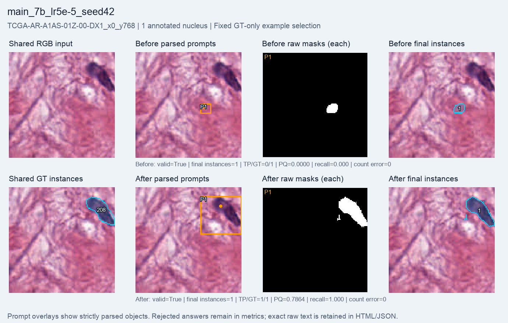
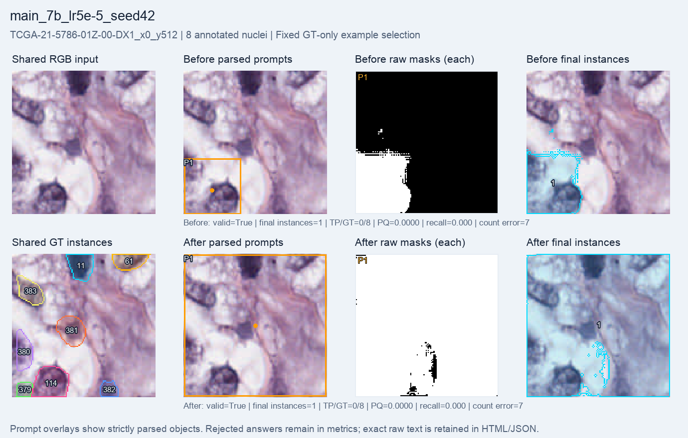

# 7B, learning rate 5e-5: 1,000-step GRPO run

A fresh Qwen2.5-VL-7B language-LoRA run completed **1,000 optimizer steps**, with **999 nonzero-gradient steps**. The final adapter hash changed; SAM2.1 tiny and the Qwen vision encoder stayed frozen. Evaluation uses the same **64 validation crops, four patients and 384 annotated nuclei** before training and after the final step.

**Macro PQ rose from 0.02265 to 0.04045; matched nuclei rose from 9 to 12.** Count MAE and format validity improved, but same-GT duplicate extras increased. Most nuclei are still missed. Higher final PQ than the matched 1e-5 run is an observed one-seed result, not a robust winner.

| Metric | Before | After 1,000 steps |
| --- | ---: | ---: |
| Macro PQ | 0.022655 | 0.040448 |
| Macro recall | 0.021540 | 0.045219 |
| Micro recall | 0.023438 | 0.031250 |
| Matched / annotated nuclei | 9 / 384 | 12 / 384 |
| Final instances | 73 | 91 |
| Count MAE | 4.921875 | 4.703125 |
| Same-GT duplicate extras | 0 | 2 |
| Raw-mask overlap pairs | 15 | 2 |
| Valid answers | 62 / 64 | 64 / 64 |
| Mean foreground IoU | 0.064296 | 0.201441 |
| Mean total reward | 1.033046 | 1.201441 |

Macro metrics average crops equally; micro recall pools matched and annotated nuclei. Count MAE uses final instances. Duplicate extras count raw SAM masks matching the same GT at IoU > 0.5; raw-mask overlap pairs are a separate proxy. These definitions can move in opposite directions. The larger foreground-IoU increase does not imply that separate nuclei are reliably found.

Two before answers failed the strict format contract; all after answers are valid. Rejected answers have empty final masks and remain in all metric denominators. Exact text is retained. The saved `adapter_changed_steps=999` means the adapter differed from its initial weights at those steps; it does not verify a change relative to every preceding step.

| Setting or resource | Value |
| --- | --- |
| Training pool | 256 selected crops, 19 patients |
| Evaluation | Full validation64: 64 crops, four patients, 384 annotated nuclei |
| Policy | Fresh Qwen2.5-VL-7B-Instruct; language LoRA rank 8 |
| Optimizer configuration | Learning rate 5e-5; seed 42; group size 2; beta 0.04 |
| Reward | Format validity + binary foreground IoU against full masks |
| Segmenter | Frozen SAM2.1 tiny |
| Completed / requested optimizer steps | 1,000 / 1,000 |
| Checkpoint evaluated here | Final step 1,000; not the best intermediate checkpoint |
| Periodic evaluations | Nine; every 100 steps before the final evaluation |
| Training-loop elapsed, including periodic evaluation/checkpoints | 3,214.162 seconds (53.569 minutes) |
| Before / after evaluation | 77.385 / 72.179 seconds |
| Total runner time | 3,382.724 seconds (56.379 minutes) |
| Training-step peak allocated memory | 17.183 GiB |
| Training-step peak reserved memory | 18.059 GiB |

Total time also includes loading and final evaluation/saving. Evaluation uses greedy generation. Train and validation patients are disjoint. The official-30 MoNuSeg training cohort supplies native 128 × 128 crops selected to contain 1–8 annotated nuclei; partial edge nuclei are retained.

## Fixed single-nucleus example

`TCGA-AR-A1AS-01Z-00-DX1_x0_y768` is the only validation64 crop with one annotated nucleus. Before training the predicted instance misses it; after training it matches (PQ 0.7864). Count error is zero in both phases, showing why count alone does not assess localization.

## Fixed multiple-nucleus example

`TCGA-21-5786-01Z-00-DX1_x0_y512` is the first eligible multi-nucleus ID lexicographically, with eight annotated nuclei. Neither phase matches a nucleus. After training the prompt spans almost the whole image and SAM produces a broad mask, but still only one final instance; count error stays seven.

Both examples were fixed by GT count and ID order before examining predictions and are identical across main64 reports. Panels show shared RGB/GT, parsed boxes/points, every raw mask and final instances. Saved GT IDs are labels, not counts; edge fragments are retained.

## Matched learning-rate comparison

| Final metric | 1e-5, seed 42 | 5e-5, seed 42 |
| --- | ---: | ---: |
| Completed steps | 1,000 | 1,000 |
| Macro PQ | 0.026685 | 0.040448 |
| Matched / annotated nuclei | 10 / 384 | 12 / 384 |
| Micro recall | 0.026042 | 0.031250 |
| Count MAE | 4.937500 | 4.703125 |
| Valid answers | 61 / 64 | 64 / 64 |
| Same-GT duplicate extras | 1 | 2 |

The saved argument sets differ only in learning rate and output path. Model metadata and initialization match; all 64 before final maps, raw-mask files and completion text files are byte-identical. Both runs completed 1,000 steps on the same dataset. This supports a controlled comparison for seed 42. It does not establish a robust preferred learning rate from one seed on reused validation. Exact reference metrics and its source-result hash are retained in `summary.json`.

## Evidence and limits

All **64 before and 64 after final maps and raw-mask files** were present and verified. Source hashes, cohort IDs/order, strict parsing, coordinate conversion, final-mask metrics, duplicate diagnostics and freeze/update proofs matched the saved evidence. All 128 raw completion records are copied byte-for-byte. No model was run to render this report.

The selected validation cohort is reused for monitoring and setting selection, not an untouched final test. Four patients and one seed limit the conclusion. Only 12 of 384 nuclei match, so reliable detection remains unresolved. Do not pool these scores with benchmark8. This is a full-mask engineering pilot, with no weak-label, SOTA or clinical claim.

[Visual report](index.html) · [Exact metrics, settings and provenance](summary.json) · [All before answers](before_records.jsonl) · [All after answers](after_records.jsonl).
