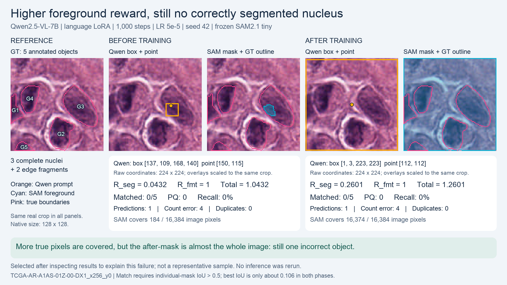

# Why a higher reward still misses every nucleus



Same real validation crop: `TCGA-AR-A1AS-01Z-00-DX1_x256_y0`. Three complete nuclei and two partial border nuclei are annotated. The comparison is Qwen2.5-VL-7B before and after 1,000 language-LoRA GRPO steps (LR 5e-5, seed 42), with frozen SAM2.1 tiny. Evaluation uses greedy decoding. No new inference or training was run to create this figure.

| Per-crop metric | Before | After |
| --- | ---: | ---: |
| R_seg: foreground IoU | 0.043203 | 0.260107 |
| R_fmt | 1 | 1 |
| Total reward | 1.043203 | 1.260107 |
| Matched instances | 0 / 5 | 0 / 5 |
| PQ / recall | 0 / 0 | 0 / 0 |
| Predicted objects | 1 | 1 |
| Absolute count error | 4 | 4 |
| Same-GT duplicate extras | 0 | 0 |

Before training, the point lies inside true nucleus 106 (display G3). The SAM mask contains only 184 pixels, all inside that nucleus, which occupies 1,738 pixels. It is a small fragment, not a correctly delineated nucleus. Foreground IoU is 184 / 4,259 = 0.0432.

After training, the point lies on annotated background. The almost full-frame box produces one mask covering 16,374 of 16,384 pixels (99.94%). It includes all 4,259 true foreground pixels and 12,115 background pixels. Foreground IoU is 4,259 / 16,374 = 0.2601. This is numerically better than the tiny initial fragment, despite the large false-positive area.

Foreground IoU **does penalize background** through its union denominator. However, it ignores which nucleus each foreground pixel belongs to. The largest IoU with any individual annotated nucleus is only about 0.106 in either phase, below the strict IoU > 0.5 matching threshold. Neither phase correctly segments an individual nucleus. “Unmatched” does not mean the after-mask covers none of the nucleus pixels.

R_fmt checks answer structure and coordinate validity, not whether the point is actually inside a real nucleus. Both answers receive R_fmt = 1. These are rewards recomputed on the same validation image, not sampled training-group rewards.

## Selection and limits

Post-hoc illustrative selection: first lexicographic validation ID with at least three complete nuclei, valid answers in both phases, one predicted instance and zero matched instances in both phases, and increased foreground IoU. This is a case explanation, not a representative sample or a new experiment. There are 15 qualifying crops. The existing fixed multi-nucleus example in the parent report is unchanged; that other crop's R_seg decreases from 0.28435 to 0.21687. Do not confuse the present illustration with that fixed example or with cohort-average improvement.

Prompts use a 224 x 224 processed coordinate frame. All overlay positions are converted to the same 128 x 128 native crop using a 128/224 scale, then enlarged only for display. G1-G5 are display labels; original IDs are preserved in case.json. Pink outlines are true boundaries, orange marks are Qwen box/point outputs, and cyan is SAM foreground. The two edge fragments remain in the five-instance denominator.

[Exact raw before answer](before.txt) · [Exact raw after answer](after.txt) · [Audited coordinates, metrics and provenance](case.json) · [Unannotated input](input.png) · [Original full64 report](../README.md)

Reproduce from the repository root:

```sh
.venv/bin/python scripts/render_reward_case.py --run runs/h200_overnight_20261016/main_7b_lr5e-5_seed42 --dataset data/monuseg_official30_grpo_v1 --output reports/2026-10-16-main-7b-lr5e-5/reward-case
```
