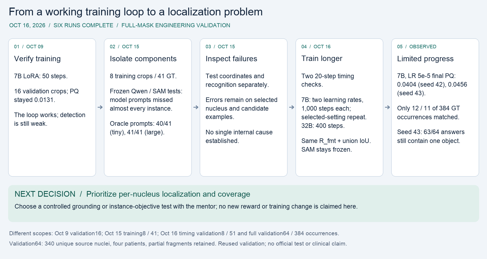
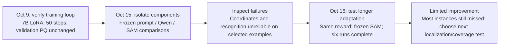

# Morning research roadmap — completed results

**COMPLETE — all six runs finished their requested steps without a recorded failure.** Final snapshot: 2026-10-16 04:02 EDT. The six model runners total 4.205 hours; the supervisor window is 4.222 hours, excluding allocation setup. This completes the experiment plan; reliable nucleus detection remains unresolved.

[Full report](index.html) · [SVG for slides](roadmap.svg) · [PNG for slides](roadmap.png)

## Why these experiments followed one another

| Stage | Evidence | Reason to continue |
| --- | --- | --- |
| October 9: training loop | 50-step 7B pilot; 16 selected validation crops, PQ stayed 0.0131. | Updates and executable answers do not establish reliable segmentation. |
| October 15: paired frozen inference | Eight training crops / 41 GT occurrences. Three-example 7B prompts matched 2/41; 32B recovered none. Larger SAM did not improve recall with those prompts. GT-derived oracle prompts matched 40/41 with tiny and 41/41 with large. | Prompt quality needs attention. Oracle results use privileged annotations. |
| October 15: targeted probes | Rectangle/single/multiple-nucleus and recognition probes showed errors on selected examples. | No single internal cause was established; separate diagnostic tasks from benchmark claims. |
| October 16: longer GRPO | Two 20-step checks, three longer main runs, and one selected-setting repeat all completed. | A working pipeline and higher foreground reward still leave severe under-detection. |

## Completed main runs — same validation64

**All 64 seed-43 answers are format-valid, but 63 emit exactly one object and one emits two. The validation cohort contains 63 multi-nucleus crops. Higher foreground union IoU and reliable formatting did not fix multi-object localization: the best main-run total remains 12/384 matched occurrences (3.125% micro recall).**

| Full64 run | Steps completed | Macro PQ before → after | Macro recall before → after | Matched GT occurrences | Valid answers |
| --- | --- | --- | --- | --- | --- |
| [7B · LR 1e-5 · seed 42](https://github.com/chowdhuryal1234/S-Seg-RLVR-/blob/codex/main-7b-lr1e-5-20261016/reports/2026-10-16-main-7b-lr1e-5/README.md) | 1,000 | 0.02265 → 0.02668 | 0.02154 → 0.02532 | 9 → 10 / 384 | 62 → 61 / 64 |
| [7B · LR 5e-5 · seed 42](https://github.com/chowdhuryal1234/S-Seg-RLVR-/blob/codex/main-7b-lr5e-5-20261016/reports/2026-10-16-main-7b-lr5e-5/README.md) | 1,000 | 0.02265 → 0.04045 | 0.02154 → 0.04522 | 9 → 12 / 384 | 62 → 64 / 64 |
| [32B · LR 1e-5 · seed 42](https://github.com/chowdhuryal1234/S-Seg-RLVR-/blob/codex/main-32b-lr1e-5-20261016/reports/2026-10-16-main-32b-lr1e-5/README.md) | 400 | 0.01414 → 0.01687 | 0.01618 → 0.02334 | 7 → 10 / 384 | 47 → 46 / 64 |
| [7B · LR 5e-5 · seed 43](https://github.com/chowdhuryal1234/S-Seg-RLVR-/blob/codex/repeat-7b-seed43-20261016/reports/2026-10-16-repeat-7b-seed43/README.md) | 1,000 | 0.02265 → 0.04555 | 0.02154 → 0.04457 | 9 → 11 / 384 | 62 → 64 / 64 |

The controlled seed-42 comparison favors LR 5e-5 on final validation PQ (0.04045 versus 0.02668), but this is a result on reused validation, not a robust preferred learning rate. The selected 5e-5 repeat reaches PQ 0.04555 with seed 43, while matched occurrences fall from 12 to 11 and count MAE worsens compared with seed 42. The repeat tests one selected setting; the 1e-5 arm was not repeated at seed 43. The 32B run used 400 steps versus 1,000 for 7B, so differences cannot be attributed solely to model size.

| Full64 run | Foreground union IoU | Count MAE | Same-GT duplicate extras | Raw-mask overlap pairs |
| --- | --- | --- | --- | --- |
| [7B · LR 1e-5 · seed 42](https://github.com/chowdhuryal1234/S-Seg-RLVR-/blob/codex/main-7b-lr1e-5-20261016/reports/2026-10-16-main-7b-lr1e-5/README.md) | 0.06430 → 0.11411 | 4.922 → 4.938 | 0 → 1 | 15 → 8 |
| [7B · LR 5e-5 · seed 42](https://github.com/chowdhuryal1234/S-Seg-RLVR-/blob/codex/main-7b-lr5e-5-20261016/reports/2026-10-16-main-7b-lr5e-5/README.md) | 0.06430 → 0.20144 | 4.922 → 4.703 | 0 → 2 | 15 → 2 |
| [32B · LR 1e-5 · seed 42](https://github.com/chowdhuryal1234/S-Seg-RLVR-/blob/codex/main-32b-lr1e-5-20261016/reports/2026-10-16-main-32b-lr1e-5/README.md) | 0.05324 → 0.04852 | 4.516 → 4.641 | 0 → 0 | 3 → 0 |
| [7B · LR 5e-5 · seed 43](https://github.com/chowdhuryal1234/S-Seg-RLVR-/blob/codex/repeat-7b-seed43-20261016/reports/2026-10-16-repeat-7b-seed43/README.md) | 0.06430 → 0.20817 | 4.922 → 4.984 | 0 → 0 | 15 → 0 |

Macro PQ and macro recall average crops equally; matched totals count crop-level occurrences. Invalid responses yield empty masks and remain in every denominator. Duplicate extras count raw SAM masks matched to the same GT at IoU > 0.5; overlap pairs measure a different event. The 5e-5 seed-42 single-nucleus crop accounts for about 69% of its net macro-PQ gain, so improvement is uneven. No denominator is changed from 384 to 340.

## Timing checks — separate validation8 subset

| Timing run | Steps | Macro PQ before → after | Matched GT occurrences | Valid answers |
| --- | --- | --- | --- | --- |
| [7B timing](https://github.com/chowdhuryal1234/S-Seg-RLVR-/blob/codex/benchmark-7b-20261016/reports/2026-10-16-benchmark-7b/README.md) | 20 | 0.01584 → 0.01098 | 1 → 1 / 51 | 8 → 8 / 8 |
| [32B timing](https://github.com/chowdhuryal1234/S-Seg-RLVR-/blob/codex/benchmark-32b-20261016/reports/2026-10-16-benchmark-32b/README.md) | 20 | 0.00000 → 0.01260 | 0 → 1 / 51 | 6 → 6 / 8 |

These eight validation crops contain 51 occurrences from 51 unique source nuclei and were fixed before outputs. They are an exact subset of validation64. They served timing/capacity checks; do not pool them with full64 or the older eight **training** crops / 41 occurrences.

## Compute and update evidence

| Run | Steps | Nonzero-gradient steps | Training-loop min | Total runner min | Peak allocated GiB |
| --- | --- | --- | --- | --- | --- |
| [7B timing](https://github.com/chowdhuryal1234/S-Seg-RLVR-/blob/codex/benchmark-7b-20261016/reports/2026-10-16-benchmark-7b/README.md) | 20 | 19 / 20 | 0.85 | 1.57 | 16.44 |
| [32B timing](https://github.com/chowdhuryal1234/S-Seg-RLVR-/blob/codex/benchmark-32b-20261016/reports/2026-10-16-benchmark-32b/README.md) | 20 | 20 / 20 | 2.54 | 4.51 | 63.67 |
| [7B · LR 1e-5 · seed 42](https://github.com/chowdhuryal1234/S-Seg-RLVR-/blob/codex/main-7b-lr1e-5-20261016/reports/2026-10-16-main-7b-lr1e-5/README.md) | 1000 | 999 / 1000 | 58.83 | 61.82 | 17.18 |
| [7B · LR 5e-5 · seed 42](https://github.com/chowdhuryal1234/S-Seg-RLVR-/blob/codex/main-7b-lr5e-5-20261016/reports/2026-10-16-main-7b-lr5e-5/README.md) | 1000 | 999 / 1000 | 53.57 | 56.38 | 17.18 |
| [32B · LR 1e-5 · seed 42](https://github.com/chowdhuryal1234/S-Seg-RLVR-/blob/codex/main-32b-lr1e-5-20261016/reports/2026-10-16-main-32b-lr1e-5/README.md) | 400 | 400 / 400 | 70.35 | 82.27 | 63.96 |
| [7B · LR 5e-5 · seed 43](https://github.com/chowdhuryal1234/S-Seg-RLVR-/blob/codex/repeat-7b-seed43-20261016/reports/2026-10-16-repeat-7b-seed43/README.md) | 1000 | 1000 / 1000 | 43.17 | 45.74 | 17.18 |

All runs used the same H200 allocation. Training-loop time includes periodic evaluation and checkpoint work; total runner time includes loading, before/after evaluation and final saving. Peak allocated memory is measured during training steps, not the entire process peak. The three 1,000-step runs each had nine intermediate evaluations; the 400-step run had three.

Every run starts a fresh base policy and new language-LoRA adapter (rank 8); SAM2.1 tiny and the Qwen vision encoder remain frozen. Rewards stay **R_fmt + binary foreground union IoU** against full reference masks. PQ, recall, count error and duplicate diagnostics are evaluation measures, not extra rewards. Main runs use the same full64 before/after evaluation and every-100-step monitoring, with greedy decoding for evaluation. These tables use final checkpoints, not the best intermediate evaluation. All six final adapters changed and all SAM/vision freeze checks passed.

## Data, limits and next decision

The frozen dataset has 256 training crops from 19 contributing patients and 64 validation crops from four different patients. Validation contains **384 crop-level GT occurrences from 340 unique source nuclei**; adjacent non-overlapping crops can include fragments of the same source nucleus. No patient or source instance crosses the new train/validation split. Sixty-one of 64 validation crops include partial nuclei. The 1–8-instance capacity filter excludes dense crops, and patient-balanced sampling changes prevalence. This is selected engineering validation, not whole-image MoNuSeg test evaluation.

Validation was reused for monitoring and setting selection, including selection of LR 5e-5 for the seed-43 repeat; it is not an untouched test. Four patients and a limited seed comparison restrict conclusions. Masks, counts and coordinates were not supplied as image-specific Qwen prompts, but the reward uses full masks: this is not weak-label training. Official test data were not used in this suite. No SOTA, clinical-accuracy or deployment claim is supported.

**Next research decision:** prioritize a controlled test of per-nucleus localization and coverage. The current reward can improve foreground coverage while leaving most separate instances unmatched. Agree with the mentor whether to test a grounding warm-up or a better-aligned instance objective, with an appropriate control, before changing the training setup. Neither change was part of this completed suite.

## Evidence by experiment

- [October 9 training](https://github.com/chowdhuryal1234/S-Seg-RLVR-/blob/main/reports/2026-10-09/README.md)
- [Paired prompt test](https://github.com/chowdhuryal1234/S-Seg-RLVR-/blob/codex/prompt-ablation-20261016/reports/2026-10-15-prompt-ablation/README.md)
- [Model/segmenter comparisons](https://github.com/chowdhuryal1234/S-Seg-RLVR-/blob/codex/followup-cd-20261016/reports/2026-10-15-followup-cd/README.md)
- [Rectangle diagnostic](https://github.com/chowdhuryal1234/S-Seg-RLVR-/blob/codex/coordinate-calibration-20261016/reports/2026-10-15-coordinate-calibration/README.md)
- [One-nucleus diagnostic](https://github.com/chowdhuryal1234/S-Seg-RLVR-/blob/codex/single-nucleus-20261016/reports/2026-10-15-single-nucleus/README.md)
- [Three-nucleus diagnostic](https://github.com/chowdhuryal1234/S-Seg-RLVR-/blob/codex/multi-nucleus-20261016/reports/2026-10-15-multi-nucleus/README.md)
- [Candidate tasks](https://github.com/chowdhuryal1234/S-Seg-RLVR-/blob/codex/recognition-coordinate-20261016/reports/2026-10-15-recognition-coordinate/README.md)
- [Isolated patches](https://github.com/chowdhuryal1234/S-Seg-RLVR-/blob/codex/isolated-crop-20261016/reports/2026-10-15-isolated-crop/README.md)
- [7B timing check](https://github.com/chowdhuryal1234/S-Seg-RLVR-/blob/codex/benchmark-7b-20261016/reports/2026-10-16-benchmark-7b/README.md)
- [32B timing check](https://github.com/chowdhuryal1234/S-Seg-RLVR-/blob/codex/benchmark-32b-20261016/reports/2026-10-16-benchmark-32b/README.md)
- [7B · LR 1e-5 · seed 42](https://github.com/chowdhuryal1234/S-Seg-RLVR-/blob/codex/main-7b-lr1e-5-20261016/reports/2026-10-16-main-7b-lr1e-5/README.md)
- [7B · LR 5e-5 · seed 42](https://github.com/chowdhuryal1234/S-Seg-RLVR-/blob/codex/main-7b-lr5e-5-20261016/reports/2026-10-16-main-7b-lr5e-5/README.md)
- [32B · LR 1e-5 · seed 42](https://github.com/chowdhuryal1234/S-Seg-RLVR-/blob/codex/main-32b-lr1e-5-20261016/reports/2026-10-16-main-32b-lr1e-5/README.md)
- [7B · LR 5e-5 · seed 43](https://github.com/chowdhuryal1234/S-Seg-RLVR-/blob/codex/repeat-7b-seed43-20261016/reports/2026-10-16-repeat-7b-seed43/README.md)

The linked standalone reports retain exact metrics, provenance, full before/after records and fixed single/multiple-nucleus examples. This roadmap is a synthesis; original raw evidence and the historical translation audit are unchanged.
