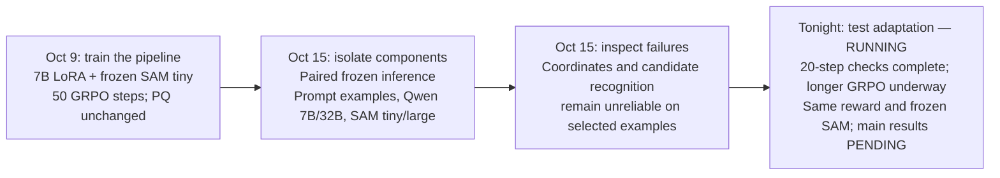

# From a working training loop to a better localization policy

**Meeting roadmap, October 16, 2026. Tonight's suite is RUNNING: both 20-step timing checks are complete; longer-run results are PENDING.**

| Stage | What the evidence supports | Why the next stage follows |
|---|---|---|
| **1. Training loop works** | October 9: 50 Qwen 7B LoRA updates completed. On 16 selected validation crops, format validity rose from 15/16 to 16/16; PQ stayed at 0.0131. | Executable answers still miss many nuclei. |
| **2. Frozen inference isolates components** | Eight official-30 training crops, 41 nuclei. A three-object format example changed 7B output counts, but only 2/41 nuclei matched. The larger Qwen checkpoint did not recover matches; larger SAM did not improve recall with the same prompts. Correct annotation-derived prompts gave SAM tiny/large 40/41 and 41/41 matches. | Prompt localization deserves attention; privileged oracle results are not automatic performance. |
| **3. Small diagnostic tasks expose errors** | Rectangle box IoU 0.648; single-nucleus box IoU 0.321. On three nuclei, five objects were emitted but an invalid box rejected the whole answer. Marked candidate classification and isolated-patch classification each scored 2/6. | Both coordinates and tissue judgments remain unreliable in these examples; no single internal cause is established. |
| **4. Test whether adaptation helps — RUNNING** | Fresh 7B/32B 20-step checks completed. On benchmark8, 7B PQ fell from 0.01584 to 0.01098 (TP stayed 1/51); 32B PQ rose from 0 to 0.01260 (TP 0 → 1/51). Longer-run outcomes remain pending. | Both configurations can train within the measured resource limits. Neither brief check establishes reliable segmentation or a model-size advantage. |

**Completed timing checks:** both used the same eight validation crops (51 annotated nuclei), with unchanged `R_fmt + foreground IoU` and frozen SAM2.1 tiny. The 7B run took 51.26 seconds for training / 94.21 seconds total and peaked at 16.44 GiB allocated during training steps; 19 of 20 steps had nonzero gradients. The 32B run took 152.65 / 270.72 seconds and peaked at 63.67 GiB; all 20 steps had nonzero gradients. These measurements set the longer-run budgets; the eight-crop scores stay separate from validation64.

**Current plan and status:** official-30 source cohort; 256 training and 64 validation crops from 19/4 disjoint patients. The 7B `1e-5` run is **running**, targeting 1,000 steps. A separate fresh 7B run at `5e-5` targets the same 1,000 steps. A fresh 32B run at `1e-5` is planned for 400 steps within a two-hour budget. All use LoRA rank 8 and seed 42. A seed-43 repeat of the selected 7B setting is optional if time remains. The eight-hour H200 allocation bounds the suite; requested steps are targets, not completed results.

**What to report tomorrow:** actual completed steps and compute cost; before/after PQ, recall, duplicate detections and count MAE on the same validation crops; format validity and reward as supporting diagnostics. If budgets differ, report the difference rather than attributing gains solely to model size.

The October 9 pilot and today's selected training-source diagnostics have different evaluation scopes and are not one common benchmark. Selection used GT; none establishes clinical accuracy, SOTA, weak-label effectiveness, or generalization. Tonight also uses full-mask rewards. The official test set remains outside this diagnostic and tuning plan.

Evidence: [October 9 training](https://github.com/chowdhuryal1234/S-Seg-RLVR-/blob/main/reports/2026-10-09/README.md), [paired prompt test](https://github.com/chowdhuryal1234/S-Seg-RLVR-/blob/codex/prompt-ablation-20261016/reports/2026-10-15-prompt-ablation/README.md), [model/segmenter comparisons](https://github.com/chowdhuryal1234/S-Seg-RLVR-/blob/codex/followup-cd-20261016/reports/2026-10-15-followup-cd/README.md), [rectangle](https://github.com/chowdhuryal1234/S-Seg-RLVR-/blob/codex/coordinate-calibration-20261016/reports/2026-10-15-coordinate-calibration/README.md), [one nucleus](https://github.com/chowdhuryal1234/S-Seg-RLVR-/blob/codex/single-nucleus-20261016/reports/2026-10-15-single-nucleus/README.md), [three nuclei](https://github.com/chowdhuryal1234/S-Seg-RLVR-/blob/codex/multi-nucleus-20261016/reports/2026-10-15-multi-nucleus/README.md), [candidate tasks](https://github.com/chowdhuryal1234/S-Seg-RLVR-/blob/codex/recognition-coordinate-20261016/reports/2026-10-15-recognition-coordinate/README.md), [isolated patches](https://github.com/chowdhuryal1234/S-Seg-RLVR-/blob/codex/isolated-crop-20261016/reports/2026-10-15-isolated-crop/README.md), [7B timing check](https://github.com/chowdhuryal1234/S-Seg-RLVR-/blob/codex/benchmark-7b-20261016/reports/2026-10-16-benchmark-7b/README.md), [32B timing check](https://github.com/chowdhuryal1234/S-Seg-RLVR-/blob/codex/benchmark-32b-20261016/reports/2026-10-16-benchmark-32b/README.md).
