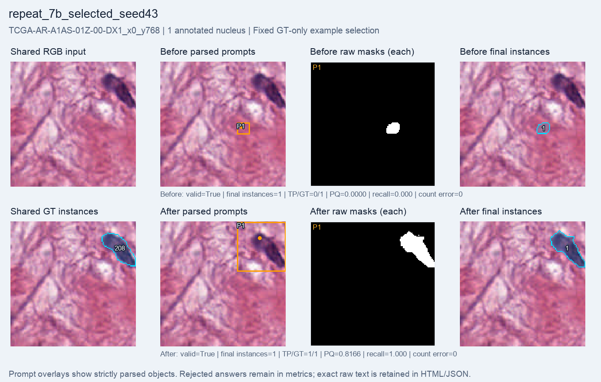
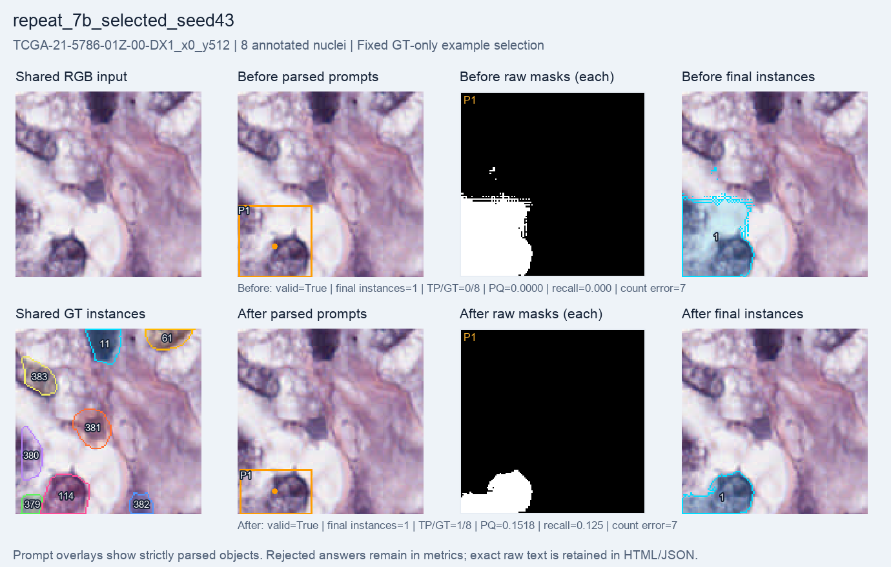

# Selected 7B setting: seed-43 repeat, 1,000 GRPO steps

A fresh Qwen2.5-VL-7B language-LoRA run repeated the selected **learning rate 5e-5** with **seed 43**, completing **1,000 optimizer steps**, all with **nonzero gradients**. The final adapter hash changed; SAM2.1 tiny and the Qwen vision encoder stayed frozen.

**Macro PQ rose from 0.02265 to 0.04555; matched GT occurrences rose from 9 to 11/384.** Count MAE worsened slightly. Compared with seed 42 at this learning rate, macro PQ is higher but the number of matches is lower and count error is worse. Most GT instances remain unmatched.

**This is a selected-setting repeat on reused validation, not an independent test.** The supervisor selected 5e-5 using final seed42 validation64 macro PQ, with macro recall as tie-breaker. Only that setting was repeated; both learning rates were not tested at both seeds.

| Metric | Before | After 1,000 steps |
| --- | ---: | ---: |
| Macro PQ | 0.022655 | 0.045552 |
| Macro recall | 0.021540 | 0.044568 |
| Micro recall | 0.023438 | 0.028646 |
| Matched / GT occurrences | 9 / 384 | 11 / 384 |
| Final instances | 73 | 65 |
| Count MAE | 4.921875 | 4.984375 |
| Same-GT duplicate extras | 0 | 0 |
| Raw-mask overlap pairs | 15 | 0 |
| Valid answers | 62 / 64 | 64 / 64 |
| Mean foreground IoU | 0.064296 | 0.208173 |
| Mean total reward | 1.033046 | 1.208173 |

After training, 63 of 64 valid answers contain exactly one object; the remaining answer contains two. The validation cohort has only one single-nucleus crop. Multi-object localization therefore remains unresolved despite higher foreground reward and fully valid output formatting.

Macro metrics average crops equally; micro recall pools matched GT occurrences. Count MAE uses final instance counts. Duplicate extras count raw SAM masks matching the same GT at IoU > 0.5; raw-mask overlap pairs are a separate proxy. Zero duplicate/overlap counts do not imply that the missing nuclei were found.

The two rejected before responses remain in all metric denominators with empty final masks; all after responses are valid. Exact raw text is retained. The saved `adapter_changed_steps=1000` counts comparisons against initial weights, not against each preceding step. Final hash change and nonzero gradients are separate evidence.

| Setting or resource | Value |
| --- | --- |
| Training pool | 256 selected crops, 19 patients |
| Evaluation | Full validation64: 64 crops, four patients, 384 GT occurrences / 340 unique source nuclei |
| Policy | Fresh Qwen2.5-VL-7B-Instruct; language LoRA rank 8 |
| Optimizer configuration | Learning rate 5e-5; seed 43; group size 2; beta 0.04 |
| Reward | Format validity + binary foreground IoU against full masks |
| Segmenter | Frozen SAM2.1 tiny |
| Completed / requested optimizer steps | 1,000 / 1,000 |
| Checkpoint evaluated here | Final step 1,000; not the best intermediate checkpoint |
| Periodic evaluations | Nine; every 100 steps before the final evaluation |
| Training-loop elapsed, including periodic evaluation/checkpoints | 2,590.140 seconds (43.169 minutes) |
| Before / after evaluation | 76.885 / 57.388 seconds |
| Total runner time | 2,744.136 seconds (45.736 minutes) |
| Training-step peak allocated memory | 17.182 GiB |
| Training-step peak reserved memory | 19.139 GiB |

Total time also includes loading and final evaluation/saving. Evaluation uses greedy generation. Train and validation patients are disjoint. All crops come from official-30 MoNuSeg training sources; native 128 × 128 crops with 1–8 annotated nuclei were selected and edge fragments retained.

## Fixed single-nucleus example

`TCGA-AR-A1AS-01Z-00-DX1_x0_y768` is the only validation64 crop with one annotated nucleus. Before training it is missed; after training it matches, with PQ 0.8166. Count error stays zero in both phases despite the earlier localization failure.

## Fixed multiple-nucleus example

`TCGA-21-5786-01Z-00-DX1_x0_y512` is the first multi-nucleus ID lexicographically, with eight GT instances. Matches rise from 0/8 to 1/8, but the model still produces only one final instance, so count error remains seven.

These are the same examples used throughout the main64 reports, fixed by GT count and ID before examining outputs. Their improvements are not representative of every crop. Panels retain shared RGB/GT, parsed boxes/points, every raw mask and final instances. GT IDs are object labels, not counts.

## Selected-setting seed comparison

| Final metric, LR 5e-5 | Seed 42, selected | Seed 43, repeat |
| --- | ---: | ---: |
| Completed steps | 1,000 | 1,000 |
| Macro PQ | 0.040448 | 0.045552 |
| Macro recall | 0.045219 | 0.044568 |
| Matched / GT occurrences | 12 / 384 | 11 / 384 |
| Micro recall | 0.031250 | 0.028646 |
| Count MAE | 4.703125 | 4.984375 |
| Valid answers | 64 / 64 | 64 / 64 |
| Same-GT duplicate extras | 2 | 0 |

Only **seed and output path** differ in the saved arguments. Model metadata and frozen-component initialization match. Initial adapter hashes differ, while all 64 initial final maps, raw-mask files and completion-text files are byte-identical. Both runs use the same selected data, reward, frozen segmenter and 1,000-step budget.

Higher macro PQ alongside lower micro recall and worse count MAE illustrates why one score is insufficient. These two runs describe variability for a validation-selected setting. They do not establish a robust preferred learning rate, a two-seed comparison of both settings or independent test performance. The exact supervisor selection decision and reference-result hash are in `summary.json`.

## Evidence and limits

All **64 before and 64 after final maps and raw-mask files** were verified, with no missing artifacts. Input hashes, cohort IDs/order, strict parsing, coordinate conversions, final-mask metrics, duplicate diagnostics and freeze/update evidence match the saved records. All 128 raw completion records are copied byte-for-byte. No model was run to render this report.

The **384 crop-level GT occurrences correspond to 340 unique source nuclei**: some nuclei cross neighboring crop borders. Fragments remain within the same patient/split, and recall retains denominator 384 rather than 340. Sixty-one of 64 validation crops contain truncated or source-clipped nuclei.

Validation was reused for monitoring, selecting the setting and evaluating this repeat. It is not an untouched final test. Four patients and two seeds for one selected setting provide limited evidence; only 11/384 GT occurrences match. Do not pool these scores with benchmark8. This is a full-mask engineering pilot, with no weak-label, SOTA or clinical claim.

[Visual report](index.html) · [Exact metrics, settings, selection and provenance](summary.json) · [All before answers](before_records.jsonl) · [All after answers](after_records.jsonl).
